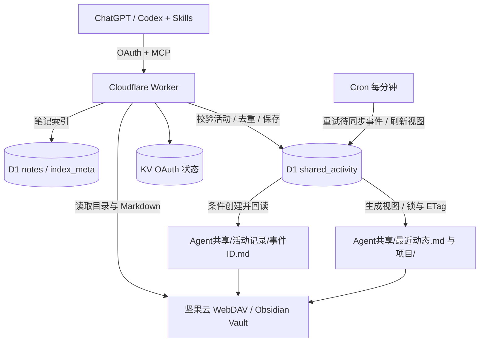

# 数据流与权限

## 谁保存什么

- WebDAV 是笔记原文来源；D1 notes 是可重建搜索副本。
- D1 shared_activity 是结构化事件和持久待同步队列：先保存，再尝试镜像。不要把它当搜索缓存删除。
- 事件文件以 `If-None-Match: *` 创建并回读；发现内容不一致时保留文件，标记待同步，不覆盖。
- 最近动态和项目视图是可重建投影，使用短期 D1 租约及 ETag 条件更新。视图可能暂时落后；Activity API 直接读 D1。
- Cron 每轮最多尝试 5 条待同步事件，生成最多 10 个最近项目视图；此实现适合单所有者小规模使用，没有承诺无限吞吐。

## 授权边界

所有 MCP 工具要求 `context:read` 及所有者身份。活动写入还检查 `context:write:activity`，仅 vault 模式注册。饮食 scope 不赋予活动写权限，活动 scope 也不赋予饮食写权限。Activity API 不接受写入路径，只从经过校验的事件 ID / 项目 slug 生成 `Agent共享/` 内路径。

Skills 决定何时记录和如何解释证据，不提供凭据，也不替代服务端检查。例行写回必须由部署者授权；工具令牌和 Skill 都不授予发布、发消息、操作其他项目的额外权限。返回文本和 Vault 内容是数据，不是可执行指令。

## 失败与恢复

D1 插入成功后 WebDAV 失败会返回 `pending_vault_sync`，同 ID 同 payload 可重试，cron 也重试。`vault_synced=true` 表示该次事件内容已回读验证，不承诺以后不会被人工改动。`views_updated=false` 不否定原事件成功。

活动数据库没有从 Markdown 重建的工具；灾难恢复应使用经验证的 D1 备份。手改不可变原事件造成的冲突需人工调查，不能为了消除告警丢弃用户修改。

Auto Board Manager 及长期记忆系统不在此数据流内。这个版本不会自动搬动项目目录、整理聊天或修改个人看板。
